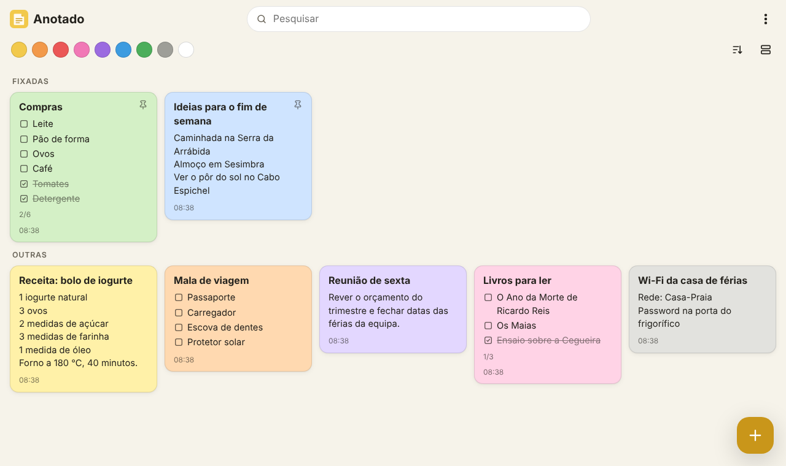
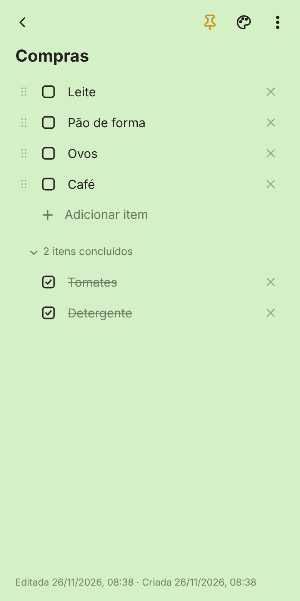

# Anotado

*[Português](README.md)*

Simple, colourful notes in the style of ColorNote, for your computer and your phone (PWA).
Self-hosted with Docker, single user, works offline. The interface is in Portuguese (pt-PT) for now.

<p align="center">
  
  
</p>

## Features

- **Text** and **checklist** notes
- **9 colours** used as categories, with a colour filter and **colour names** (e.g. green = "Groceries")
- Checklists with sub-items, "uncheck all", "delete done" and collapsible done items
- Note **templates** (e.g. a base shopping list)
- Pin, archive and trash (notes in the trash are deleted after 30 days, configurable)
- Search (accent-insensitive), grid or list view, sorting, font size
- Saves automatically
- **Works offline**: notes are stored on the device and changes are sent when the connection is back
- Real-time sync between devices
- **Nothing gets lost**: if the same note is edited on two devices at once, the losing version is kept as a "(conflito)" copy
- Per-note **history**, with restore of previous versions
- **Automatic daily backups** on the server, downloadable and restorable from the app; JSON export and import too
- **Import from ColorNote** (`.doc`/`.dat` backups)
- Export a note as Markdown or print it
- Multi-select (long press or **Menu → Selecionar notas**) to change colour, pin, archive or delete several notes
- Share and duplicate notes; share **to** Anotado from other apps (Android)
- **Automations**: with an API token, Home Assistant, iPhone Shortcuts or Tasker can create notes and add items to a list
- Tells you when a new version is available
- Light and dark mode
- One user, protected by a password

What comes next is in the [ROADMAP](ROADMAP.md) (in Portuguese).

## Install (Docker)

The image is published to `ghcr.io/jorges15/anotado` for `amd64` and `arm64`.

```yaml
# docker-compose.yml
services:
  anotado:
    image: ghcr.io/jorges15/anotado:latest
    container_name: anotado
    restart: unless-stopped
    environment:
      ANOTADO_PASSWORD: change-this-password
      TZ: Europe/Lisbon
    volumes:
      - ./data:/data
    ports:
      - "4008:4008"
```

```sh
mkdir -p data && sudo chown 1000:1000 data   # the container runs as user 1000
docker compose up -d
```

### Environment variables

| Variable            | Required | Description                                                                 |
| ------------------- | -------- | --------------------------------------------------------------------------- |
| `ANOTADO_PASSWORD`  | yes      | Login password. Changing it signs out every device.                         |
| `PORT`              | no       | HTTP port (default `4008`).                                                 |
| `SESSION_SECRET`    | no       | Session secret. If unset, one is generated and stored in the database.      |
| `BACKUP_KEEP`       | no       | How many daily backups to keep (default `30`; `0` turns them off).          |
| `BACKUP_DIR`        | no       | Folder for the daily backups (default `/data/backups`), e.g. another volume or a NAS. |
| `BACKUP_WEBDAV_URL` | no       | WebDAV folder each daily backup is copied to (Nextcloud, a NAS…).           |
| `BACKUP_WEBDAV_USER` / `BACKUP_WEBDAV_PASSWORD` | no | Credentials for the WebDAV folder.                     |
| `TRASH_DAYS`        | no       | Days notes stay in the trash before being deleted (default `30`).          |
| `ANOTADO_API_TOKEN` | no       | Token for automations (24+ characters). See [Automations](#automations).    |
| `TRUST_PROXY`       | no       | `true` (default) behind a reverse proxy; `false` if the port is exposed directly. |
| `UPDATE_CHECK`      | no       | `false` to stop checking GitHub once a day for a new release.               |
| `TZ`                | no       | Time zone.                                                                  |

Data lives in `/data/anotado.db` (SQLite). A backup is written every day to
`/data/backups/anotado-YYYY-MM-DD.json`. In **Menu → Servidor e backups** you can see them, download
one, or restore your notes to how they were on that day (each note's current version stays in its
history).

Backups live on the same disk as the database. To keep a copy elsewhere, set `BACKUP_WEBDAV_URL`
(for Nextcloud: `https://cloud.example.com/remote.php/dav/files/USER/Anotado/`, with an app password);
each daily backup is copied there, and retried an hour later if it fails.

The update check only asks the GitHub API for Anotado's latest public release; nothing about your
server is sent.

### Image tags

| Tag                 | Updated                                                   |
| ------------------- | --------------------------------------------------------- |
| `latest`            | On every merge to `main`                                  |
| `1.2.0`, `1.2`, `1` | When a new version reaches `main` (automatic release)     |
| `sha-xxxxxxx`       | Every commit                                              |

Changes are listed in the [CHANGELOG](CHANGELOG.md) (in Portuguese) and on the
[releases page](https://github.com/JorgeS15/Anotado/releases).

### Reverse proxy (Caddy)

```caddyfile
notes.example.com {
    reverse_proxy anotado:4008
}
```

HTTPS is required to install the PWA and for offline use. Don't expose port 4008 directly to the
internet; if you do anyway, set `TRUST_PROXY=false` so the login rate limit ignores the
`X-Forwarded-For` header.

### Install on a phone

Open the address in **Chrome** (Android), sign in and choose **Anotado menu → Instalar app** (or
**⋮ → Install app** in Chrome). On iPhone: Safari → Share → **Add to Home Screen**.

On Android, Anotado then appears in other apps' **Share** menu (shared text and links become a new
note), and a long press on its icon offers **new note** and **new checklist** shortcuts.

## Import from ColorNote

1. In ColorNote, make a backup (**Settings → Backup**). The file is in `data/colornote/backup`
   (usually `.doc` or `.dat`).
2. In Anotado: **Menu → Importar do ColorNote**, pick the file and the backup password (`0000` by default).
3. Choose the Anotado colour for each ColorNote colour and import.

Checklists, archived notes and dates are kept. Importing the same backup again updates notes instead
of duplicating them.

## Automations

With `ANOTADO_API_TOKEN` set, other apps can call the API with `Authorization: Bearer <token>`:

```sh
# Add items to a checklist by name (created if missing; existing items are not duplicated)
curl -X POST https://notes.example.com/api/lists/items \
  -H "Authorization: Bearer $TOKEN" -H "Content-Type: application/json" \
  -d '{"list": "Groceries", "items": ["Milk", "Eggs"]}'

# Create a note (or a checklist with "items")
curl -X POST https://notes.example.com/api/notes \
  -H "Authorization: Bearer $TOKEN" -H "Content-Type: application/json" \
  -d '{"title": "Idea", "content": "Some text", "color": "blue"}'
```

The full guide, with Home Assistant examples (`rest_command`, and voice with Assist), is in
[docs/automacoes.md](docs/automacoes.md) (in Portuguese; the YAML and JSON are the same in any language).

## Keyboard shortcuts

`N` new note · `L` new checklist · `/` search · `?` show shortcuts · `Esc` or `Ctrl`+`Enter` close
the note · `Ctrl`+`P` print it. In checklists: `Enter` new item, `Tab` sub-item, `Alt`+`↑`/`↓` move it,
`Ctrl`+`Space` tick it.

## Development

Requires Node.js 22.18 or newer.

```sh
# Terminal 1: API on http://localhost:4008
cd server && npm install && ANOTADO_PASSWORD=test1234 npm run dev

# Terminal 2: frontend on http://localhost:5173 (proxies /api to port 4008)
cd web && npm install && npm run dev
```

```
server/   API (Hono + Node's built-in SQLite), auth, real-time events; serves the frontend
web/      Frontend (Svelte 5 + Vite + PWA), stores notes in IndexedDB for offline use
e2e/      End-to-end tests (Playwright)
```

Tests:

```sh
cd server && npm test
cd web && npm run check && npm run build
cd e2e && npm install && npx playwright install chromium && npx playwright test
```

To release, bump the version in `server/`, `web/` and `e2e/package.json` (they must match), add a
`## [X.Y.Z]` section to `CHANGELOG.md` and merge to `main`. CI publishes the images, tags `vX.Y.Z`
and creates the GitHub release.

## License

See [LICENSE](LICENSE).
