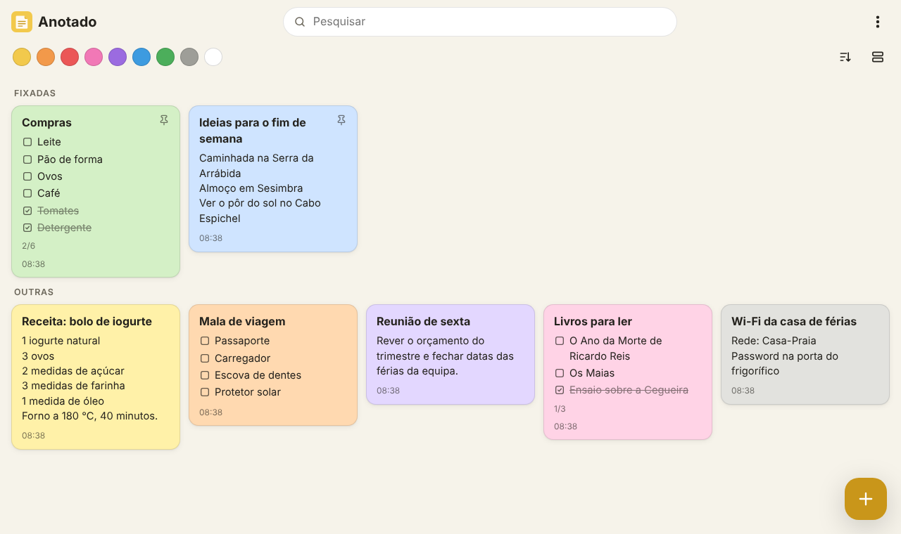
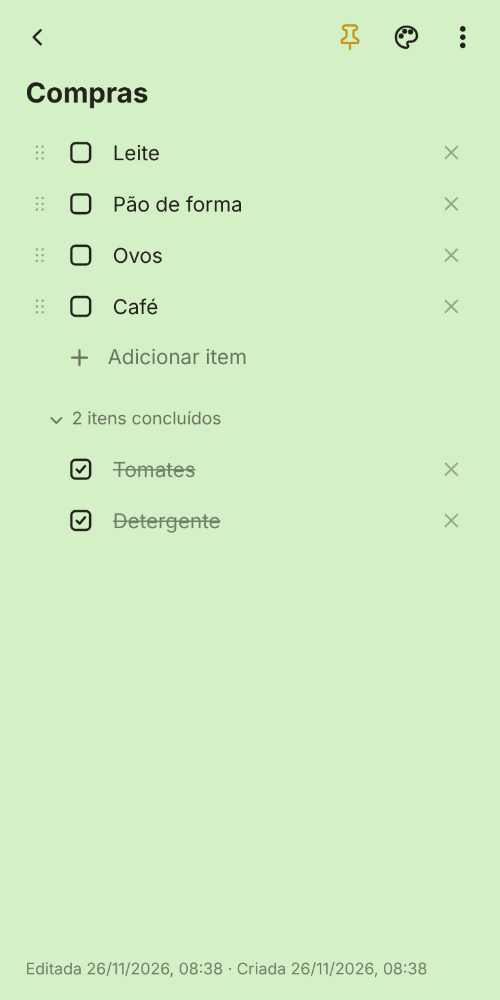

# Anotado

*[English](README.en.md)*

Notas simples e coloridas, ao estilo do ColorNote, para usar no PC e no telemóvel (PWA).

<p align="center">
  
  
</p>

- Notas de **texto** e **checklist**
- **9 cores** que servem de categorias, com filtro por cor e **nomes para as cores** (ex.: verde = "Compras")
- Checklists com sub-itens, "Desmarcar tudo", "Apagar concluídos" e concluídos recolhíveis
- **Modelos** de notas (ex.: lista de compras base)
- Fixar, arquivar e lixo (as notas no lixo são apagadas ao fim de 30 dias, configurável)
- Pesquisa (ignora acentos), vista em grelha ou em lista, ordenação, tamanho da letra
- Guarda automaticamente
- **Funciona offline**: as notas ficam guardadas no dispositivo e as alterações são enviadas quando a ligação voltar
- Sincronização em tempo real entre dispositivos
- **Nada se perde**: se a mesma nota for editada em dois dispositivos ao mesmo tempo, a versão que perde fica guardada como "(conflito)"
- **Histórico** de cada nota, com restauro de versões anteriores
- **Backups diários automáticos** no servidor, que se podem descarregar e restaurar a partir da app;
  também exportar e importar backup (JSON)
- Exportar uma nota em Markdown ou imprimi-la
- **Importar do ColorNote** (backup `.doc`/`.dat`)
- Seleção múltipla (toque longo ou **Menu → Selecionar notas**) para mudar cor, fixar, arquivar ou apagar várias notas de uma vez
- Partilhar e duplicar notas; partilhar de outras apps **para** o Anotado (Android)
- Modo claro e escuro
- **Automações**: com um token de API, o Home Assistant, os Atalhos do iPhone ou o Tasker podem
  criar notas e acrescentar itens a uma lista ([guia](docs/automacoes.md))
- Avisa quando há uma versão nova
- Um só utilizador, protegido por password

O que vem a seguir está no [ROADMAP](ROADMAP.md).

## Instalação (Docker)

A imagem é publicada automaticamente em `ghcr.io/jorges15/anotado` a cada merge para `main`,
para `amd64` e `arm64`.

```yaml
# docker-compose.yml
services:
  anotado:
    image: ghcr.io/jorges15/anotado:latest
    container_name: anotado
    restart: unless-stopped
    environment:
      ANOTADO_PASSWORD: muda-esta-password
      TZ: Europe/Lisbon
    volumes:
      - ./data:/data
    ports:
      - "4008:4008"
```

```sh
mkdir -p data && sudo chown 1000:1000 data   # o contentor corre como utilizador 1000
docker compose up -d
```

### Variáveis de ambiente

| Variável           | Obrigatória | Descrição                                                                    |
| ------------------ | ----------- | ---------------------------------------------------------------------------- |
| `ANOTADO_PASSWORD` | sim         | Password de acesso. Mudá-la termina a sessão em todos os dispositivos.       |
| `PORT`             | não         | Porta HTTP (por omissão `4008`).                                             |
| `SESSION_SECRET`   | não         | Segredo das sessões. Se não for definido, é gerado e guardado na base de dados. |
| `BACKUP_KEEP`      | não         | Quantos backups diários guardar (por omissão `30`; `0` desliga).             |
| `TRASH_DAYS`       | não         | Dias que as notas ficam no lixo antes de serem apagadas (por omissão `30`).  |
| `ANOTADO_API_TOKEN` | não        | Token para automações (24+ caracteres). Ver [Automações](docs/automacoes.md). |
| `TRUST_PROXY`      | não         | `true` (por omissão) atrás do Caddy; `false` se a porta estiver exposta diretamente. |
| `UPDATE_CHECK`     | não         | `false` para não verificar uma vez por dia se há uma versão nova no GitHub.  |
| `TZ`               | não         | Fuso horário.                                                                |

Os dados ficam em `/data/anotado.db` (SQLite). Todos os dias é escrito um backup em
`/data/backups/anotado-AAAA-MM-DD.json` (os últimos 30 são mantidos). Em **Menu → Servidor e backups**
vês a lista, descarregas um backup ou restauras as notas como estavam nesse dia (a versão atual de cada
nota fica no histórico). Também podes copiar a pasta `data` ou usar **Menu → Exportar backup**.

A verificação de versões só pede a última release pública do Anotado à API do GitHub; não envia
nada sobre o teu servidor.

### Versões da imagem

| Tag                    | Quando é atualizada                              |
| ---------------------- | ------------------------------------------------ |
| `latest`               | A cada merge para `main`                         |
| `1.1.0`, `1.1`, `1`    | Quando uma versão nova chega ao `main` (release automática) |
| `sha-xxxxxxx`          | Cada commit                                      |

Para fixar uma versão, usa por exemplo `ghcr.io/jorges15/anotado:1.1`. As alterações de cada versão
estão no [CHANGELOG](CHANGELOG.md).

### Caddy

```caddyfile
notas.teudominio.pt {
    reverse_proxy anotado:4008
}
```

Se o Caddy não estiver na mesma rede Docker, usa `reverse_proxy localhost:4008`.
O HTTPS é necessário para instalar a PWA e para a app funcionar offline.
Não exponhas a porta 4008 diretamente à internet; usa sempre o Caddy à frente. Se mesmo assim o
fizeres, define `TRUST_PROXY=false`, para o limite de tentativas de login não confiar no cabeçalho
`X-Forwarded-For`, que nesse caso qualquer um pode inventar.

### Instalar no telemóvel

Abre o endereço no **Chrome** (Android), entra com a password e escolhe **Menu do Anotado → Instalar app**
(ou **⋮ → Instalar app** no Chrome). A app passa a aparecer na lista de apps e na pesquisa do telemóvel.

> Se escolheres "Adicionar ao ecrã principal → Criar atalho", fica só um atalho (com o símbolo do Chrome no ícone)
> que não aparece na lista de apps. Nesse caso apaga-o e instala de novo como acima.

No iPhone: Safari → Partilhar → **Adicionar ao ecrã principal**.

Com a app instalada no Android:

- O Anotado aparece no menu **Partilhar** das outras apps: texto e links partilhados viram uma nota nova.
- Um toque longo no ícone mostra os atalhos **Nova nota** e **Nova checklist**.
- A app pede ao sistema para não apagar as notas guardadas no telemóvel, mesmo com pouco espaço.
- Quando há uma versão nova, aparece um aviso com o botão **Atualizar**.

## Importar do ColorNote

1. No ColorNote, faz um backup (**Definições → Backup**). O ficheiro fica em `data/colornote/backup`
   (normalmente `.doc` ou `.dat`).
2. No Anotado: **Menu → Importar do ColorNote**, escolhe o ficheiro e a password do backup
   (por omissão `0000`).
3. Escolhe a cor do Anotado para cada cor do ColorNote (há exemplos de notas para ajudar) e importa.

As checklists, notas arquivadas e datas são mantidas. Importar o mesmo backup outra vez atualiza
as notas em vez de as duplicar. O formato do ColorNote não é público: se o teu backup não for
reconhecido, abre uma issue.

## Automações

Com `ANOTADO_API_TOKEN` definido, outras apps podem criar notas e acrescentar itens a uma checklist
pelo nome, por exemplo para dizer ao Home Assistant *"adiciona leite à lista de compras"*:

```sh
curl -X POST https://notas.teudominio.pt/api/lists/items \
  -H "Authorization: Bearer $TOKEN" -H "Content-Type: application/json" \
  -d '{"list": "Compras", "items": ["Leite"]}'
```

O guia completo, com exemplos para o Home Assistant (incluindo voz com o Assist), Atalhos do iPhone
e Tasker, está em [docs/automacoes.md](docs/automacoes.md).

## Atalhos de teclado (PC)

| Tecla          | Ação                                |
| -------------- | ----------------------------------- |
| `N`            | Nova nota de texto                  |
| `L`            | Nova checklist                      |
| `/`            | Pesquisar                           |
| `?`            | Mostrar os atalhos                  |
| `Esc`          | Fechar a nota / limpar a pesquisa   |
| `Ctrl`+`Enter` | Fechar a nota                       |
| `Ctrl`+`P`     | Imprimir a nota aberta              |

Nas checklists, `Enter` cria um novo item, `Tab` torna-o sub-item, `Backspace` num item vazio apaga-o, `Alt`+`↑`/`↓` move o
item e `Ctrl`+`Espaço` marca-o. `Ctrl`+clique numa nota seleciona-a; `Esc` cancela a seleção.

## Desenvolvimento

Requer Node.js 22.18 ou mais recente.

```sh
# Terminal 1: API em http://localhost:4008
cd server && npm install && ANOTADO_PASSWORD=teste npm run dev

# Terminal 2: frontend em http://localhost:5173 (encaminha /api para a porta 4008)
cd web && npm install && npm run dev
```

Estrutura:

```
server/   API (Hono + SQLite nativo do Node), autenticação, eventos em tempo real; serve o frontend
web/      Frontend (Svelte 5 + Vite + PWA), guarda as notas em IndexedDB para uso offline
e2e/      Testes end-to-end (Playwright)
```

Sincronização: cada alteração é guardada primeiro no dispositivo e posta numa fila, que é enviada
para o servidor quando há ligação. Cada dispositivo envia a versão em que se baseou; se outro
dispositivo alterou a nota entretanto, ganha a edição mais recente e a outra fica como "(conflito)".
As horas são corrigidas pelo relógio do servidor, para um telemóvel com a hora errada não estragar isto.

### Testes

```sh
cd server && npm test                 # testes do servidor (node:test)
cd web && npm run check && npm run build
cd e2e && npm install && npx playwright install chromium && npx playwright test
```

O CI corre tudo isto em cada PR, antes de construir a imagem. O Dependabot abre PRs semanais
com atualizações de dependências.

### Lançar uma versão

1. Num PR, atualiza a versão em `server/package.json`, `web/package.json` e `e2e/package.json`
   (têm de ser iguais) e acrescenta a secção `## [X.Y.Z]` ao `CHANGELOG.md`.
2. Faz merge. O CI publica as imagens `X.Y.Z`, `X.Y` e `X`, cria a tag `vX.Y.Z` e a release no GitHub
   com as notas dessa secção do CHANGELOG. Não é preciso fazer mais nada.

Merges sem mudança de versão só atualizam a imagem `latest`.
